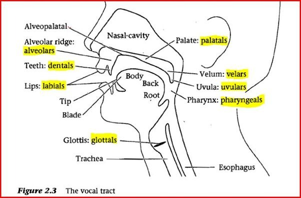

- **The Respiratory System:** Los pulmones proveen el flujo de aire esencial (*airstream*).
- **The Phonatory System:** La laringe y las cuerdas vocales (*Vocal Cords*). Aquí se decide si un sonido es sonoro (vibra) o sordo (no vibra).
- **The Articulatory System:** La cavidad oral y nasal. Los articuladores activos (lengua, labios) y pasivos (dientes, paladar duro, velo del paladar).

### Diagrama 1: The Vocal Tract (el tracto vocal)

Observa los puntos de articulación resaltados: ==labials==, ==dentals==, ==alveolars==, ==palatals==, ==velars==, ==uvulars==, ==pharyngeals== y ==glottals==. Ubica también la cavidad nasal (*nasal cavity*), las partes de la lengua (*tip, blade, body, back, root*), la tráquea (*trachea*) y el esófago (*esophagus*).

### Diagrama 2: Speech Organs Labeling

Los 10 órganos principales del habla. Toca cada ficha para ver su nombre en español y luego ubícalos en el **mapa interactivo** de la sección *Quizzes y juegos*.

<b>1</b> Nose
Nariz

<b>2</b> Upper lip
Labio superior

<b>3</b> Lower lip
Labio inferior

<b>4</b> Upper teeth
Dientes superiores

<b>5</b> Lower teeth
Dientes inferiores

<b>6</b> Alveolar ridge
Alvéolos (cresta alveolar)

<b>7</b> Hard palate
Paladar duro

<b>8</b> Soft palate (velum)
Paladar blando (velo del paladar)

<b>9</b> Pharynx
Faringe

<b>10</b> Tongue
Lengua

