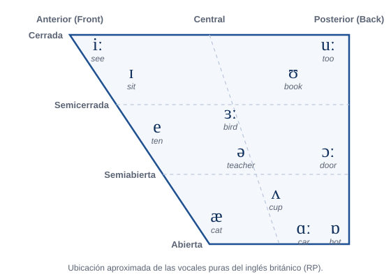

- **Vocales Anteriores (Front Vowels):** `/iː/` (see), `/ɪ/` (sit), `/e/` (ten), `/æ/` (cat).
- **Vocales Centrales (Central Vowels):** `/ɜː/` (bird), `/ə/` (teacher — *The Schwa, el sonido más común del inglés*), `/ʌ/` (cup).
- **Vocales Posteriores (Back Vowels):** `/uː/` (too), `/ʊ/` (book), `/ɔː/` (door), `/ɒ/` (hot), `/ɑː/` (car).
- **Diptongos:** Movimiento de una vocal a otra dentro de la misma sílaba (ej. `/aɪ/` en *my*, `/eɪ/` en *say*).
